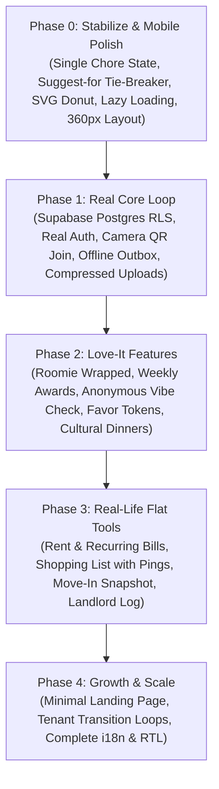

# Roomie — Master Product Roadmap & Implementation Blueprint

> **Reference Document:** Companion to `Build Spec (v1)`, `Design and Branding Doc (v1)`, and `Data Handling and Offline Spec`.

---

## 1. Core Vision & Principles

**Roomie** is a mobile-first companion app for shared apartments and international student flats to run their living spaces with radical fairness, warm connection, and zero power asymmetry.

### The Five Pillars
1. **Money**: Fair, agreement-first cost sharing and simplified bilateral settlements.
2. **Chores**: Fair, effort-balanced chore division via secret drafts and animated reveal ceremonies.
3. **House Rules**: Cooperative agreements on habits, quiet hours, and shared flat standards.
4. **Connection**: Celebrations, kudos, cultural dinners, and cooperative challenges without toxic comparisons.
5. **Belonging**: Respectful joining, fair admin handover, and clean moving-out workflows.

---

## 2. Universal Safeguards & Guardrails

| Category | Guardrail Rule |
|---|---|
| **Tone & Psychology** | **Zero-Shame Policy**: No public rankings, no numbered "worst flatmate" leaderboards, and no accusatory notifications. Streaks are protected during illness or exams via Away Mode. |
| **Financial Boundary** | **No Real Money Movement**: Roomie tracks, reminds, simplifies, and records. It never holds escrow, moves funds, or touches payment gateways. |
| **Performance Budget** | **Strict 200 KB Initial JS**: First screen bundle must remain under 200 KB gzipped. Secondary screens and modals must be lazy-loaded. Dependencies over 20 KB gzipped require approval. |
| **Data & Isolation** | **Multi-Tenant Row-Level Security (RLS)**: Active household membership strictly guards all database access. Pending join requests never leak into household rosters, presence, or split calculations. |
| **Feature Cycle** | **The 6-Step Rule**: Domain Type Definition → Data Layer Method (`api.ts`) → Token-Based UI Component → Unit Test → Build & Lint Check → Commit & `PROJECT_STATE.md` update. |

---

## 3. Phased Execution Roadmap



---

### Phase 0: Stabilize & Polish (Current Baseline)
- [x] Single-source chore draft state (`getChoreDraftState()`) reading across Home, Notifications, Chat, and Banners.
- [x] `suggest_for` integrated into matching as a tie-breaker; strictly honors `avoid` picks and prohibits pushing `heavy` chores.
- [x] Deleted legacy orphan screens (`MeetingsScreen.tsx`, `MembersScreen.tsx`).
- [x] Replaced `recharts` with lightweight custom SVG donut chart (uninstalled 39 packages).
- [x] Lazy-loaded all screens and modals with `React.lazy` and Suspense skeleton fallbacks. Initial JS payload reduced to **~99 kB gzip**.
- [x] Unit test suite passing with 13 tests.
- [ ] Mobile viewport audit & responsiveness verification on narrow screens (360px and 390px).

---

### Phase 1: The Core Loop (Completed & Verified 100% ✅)
*Objective: Deploy to one real shared flat for 2 weeks with 100% data integrity across online/offline cycles.*

- [x] **Supabase Backend & Multi-Tenant RLS**:
  - Live PostgreSQL database with 15 tables and atomic security functions (`join_household_by_code`, `approve_join_request`, `leave_household_self`).
  - Row-Level Security (RLS) enforcing strict household isolation across members, chores, expenses, and chats.
  - Dual-mode data layer with automatic Supabase connection and local offline fallback.
- [x] **Camera QR Scan & Join Flow**:
  - Real-time QR code generation (`qrcode`) and camera scanner using Web `BarcodeDetector` API with `jsQR` fallback.
  - One-tap "Share on WhatsApp" and copyable deep links (`https://roomie.app/join/...` and `roomie://invite/...`).
- [x] **Offline-First Outbox Queue**:
  - Idempotent transaction buffer (`src/services/outbox.ts`) for expenses, chore completions, kudos, settlements, and chats.
  - Optimistic UI state updates with automatic conflict-free replay and status sync indicator.
- [x] **Client-Side Photo Compression Pipeline**:
  - Automated canvas-based image compression (`src/utils/photoPipeline.ts`) ensuring receipt and chore proof photos stay under 150-300 KB.
  - Uploads to private Supabase Storage buckets (`receipts`, `chore-proof`).
- [x] **PWA Installation & Native Android Shell**:
  - Standalone Capacitor Android APK built and verified offline on mobile device.
  - `manifest.json`, PWA installation banner prompt (`window.deferredPrompt`), and Service Worker push listener (`public/sw.js`).
- [x] **Tactile Duolingo Design & Secret Easter Egg**:
  - 100% unified 3D tactile buttons, mobile bottom-sheet drag pills, status bar notch safety (`pt-safe`, `pb-safe`), and 5-tap developer Easter egg to keep UI clean for roommates.

---

### Phase 2: The Features People Love (Engagement Without Toxicity — Core Rituals Completed ✅)
*Objective: Build delightful daily rituals that turn shared living into a positive shared experience.*

- [x] **1. Weekly Awards (Everyone Wins)**:
   - System rotates humorous, uplifting badges (*Kitchen Hero*, *Bin Boss*, *Night Chef*, *Peacemaker*, *Streak Master*, *Early Bird*, *The Dependable*, *Flat Cheerleader*) using pre-registered offline `fluent-emoji-flat` vector SVGs.
   - Nominations automatically derived from kudos and on-time completions. No flatmate is ever ranked last.
   - Paired with unclipped confetti celebration burst and ascending C-Major triad arpeggio (`awardCelebrate`) + double-pulse haptic fanfare.
- [x] **2. Weekly Vibe Check**:
   - 1-tap weekly mood pulse (5 expressive vector faces: *On Fire*, *Super Chill*, *Just Okay*, *A Bit Stressed*, *Feeling Low*).
   - **Privacy Guardrail**: Completely anonymous; individual answers are never stored with user IDs. Apartment average is displayed only after at least 3 flatmates submit (`submit_anonymous_vibe` RPC & k-anonymity RLS).
   - Empathetic sensory feedback: warm F-Major dyad swell (`vibeSubmit`) for high/neutral moods and soft descending notice for stressed/low moods.
- [x] **3. Favor Tokens & Chore Swaps**:
   - Social ledger (earn tokens via chore streaks and helpful acts; spend 1–2 tokens to propose a chore swap).
   - Hard individual token ceiling (`MAX_FAVOR_TOKENS = 10`) prevents hoarding and automatically converts excess streak/award/swap tokens into celebratory flatmate kudos (`resolve_chore_swap` atomic row-locked RPC).
   - Distinct tactile audio & haptic signatures (`tokenClink`, `swapAccept`, `softReject`) and idempotent offline outbox integration (`submit_vibe_pulse`, `propose_chore_swap`, `resolve_chore_swap`).
- [x] **4. Roomie Wrapped (Monthly & Semester Recap) - Phase 2B Beta**:
   - Gated behind `roomieWrappedBeta` feature flag (`src/config/featureFlags.ts`).
   - 4-slide interactive story deck summarizing flat milestones: team chores, dispute-free streaks, culinary highlights, appreciation kudos, and harmony rating (`src/features/feed/components/RoomieWrappedModal.tsx`).
- [x] **5. Apartment Challenges & Cultural Dinners - Phase 2B Beta**:
   - Gated behind `culturalDinnersBeta` feature flag (`src/config/featureFlags.ts`).
   - Cultural dinner hosting flow, RSVP management, dietary preference profiles (Halal, Vegetarian, Vegan, Nut-Free, Gluten-Free, Dairy-Free), and flatmates dietary overview (`src/features/feed/components/CulturalDinnerCard.tsx` & `CulturalDinnerModal.tsx`).
- [x] **6. Shareable Cards (Zero Financial Figures)**:
   - High-definition 1080x1920 (9:16 story aspect ratio) HTML5 `<canvas>` story exporter (`src/utils/shareCardCanvas.ts`) with native Web Share API and PNG download fallback (strictly zero monetary numbers, debts, or private IDs).

---

### Phase 3: Real-Life Flat Tools
*Objective: Eliminate day-to-day flat administration headaches.*

1. **Rent & Recurring Bills**:
   - Templates for recurring rent, Wi-Fi, and utilities with customizable split rules (equal, room-size, or percentage-based).
   - Reminders sent to payers; collectors confirm receipt.
- [x] **2. Shared Shopping List with Live Pings** (Completed ✅):
   - Collaborative checklist with running-low tags, category filter chips (`groceries`, `household`, `cleaning`, `pantry`), and 1-tap *"I'm going to the supermarket"* broadcast button (`ShoppingListCard.tsx` & `ShoppingListModal.tsx`).
   - Batch conversion of in-cart items into an agreed shared expense with automatic status update to `purchased`.
3. **Move-in Condition Snapshot**:
   - Room-by-room dated photo inventory verified and confirmed by all tenants upon move-in.
   - Exportable as a deposit-protecting PDF.
4. **Maintenance & Landlord Hub**:
   - Landlord/superintendent contact card and issue tracker (`reported` → `notified landlord` → `fixed`).
   - Warning banner prohibiting identity documents (passports, visas).
- [x] **5. Apartment Info Card & Wi-Fi Card** (Completed ✅):
   - Visible to active members only: Wi-Fi credentials with 1-tap masked/reveal toggle and clipboard copy button, trash collection schedule, emergency shutoff notes, and street address with delivery driver instructions (`ApartmentInfoCard.tsx` embedded in `ApartmentScreen.tsx`).
   - Client-side and database-level RLS with strict identity document prohibition constraint (`no_identity_documents`).
6. **Apartment Agreement PDF**:
   - Compiled PDF export of all agreed house rules and meeting outcomes with tenant sign-off timestamps.

---

### Phase 4: Growth & Expansion
1. Minimalist high-converting landing page with email waitlist.
2. Tenant transition loops: users moving to a new flat keep their account, personal streak history, and verified reputation while transitioning household data cleanly.
3. Full translation and RTL layout completion across English, Turkish, French, and Arabic.

---

## 4. Database Schema Specification (Supabase / Postgres)

Every table includes standard sync fields:
- `id` UUID PRIMARY KEY DEFAULT gen_random_uuid()
- `created_at` TIMESTAMPTZ DEFAULT now()
- `updated_at` TIMESTAMPTZ DEFAULT now()
- `deleted_at` TIMESTAMPTZ NULL
- `version` INTEGER DEFAULT 1

### Core Relational Hierarchy
```
households
├── memberships (user_id, household_id, role, status)
├── join_requests (votes JSONB)
├── expenses (paid_by, category, amount, status)
│   └── expense_shares (user_id, share_amount, response)
├── settlements (from_user, to_user, amount, status)
├── chores (frequency, effort_level, active)
│   └── chore_assignments (user_id, scheduled_days, completed_today, kudos)
├── draft_rounds (status: collecting, ready_to_reveal, revealed)
│   └── draft_picks (user_id, chore_id, pick_type, target_user_id)
├── chat_messages (sender_id, type, body, reactions)
├── meeting_topics (proposed_by, votes, comments)
├── house_agreements (text, category)
├── recurring_bills (due_day, split_rule)
├── shopping_items (added_by, status, is_low)
├── move_in_snapshots (room_name, photos, confirmed_by)
├── maintenance_issues (title, status, photos)
├── vibe_pulses (week_start, score) -- anonymous aggregate
└── favor_tokens (user_id, balance, history)
```
