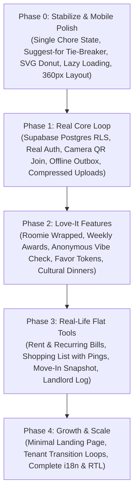

# Roomie — Master Product Roadmap & Implementation Blueprint

> **Reference Document:** Companion to `Build Spec (v1)`, `Design and Branding Doc (v1)`, and `Data Handling and Offline Spec`.

---

## 1. Core Vision & Principles

**Roomie** is a mobile-first companion app for shared apartments and international student flats to run their living spaces with radical fairness, warm connection, and zero power asymmetry.

### The Five Pillars
1. **Money**: Fair, agreement-first cost sharing and simplified bilateral settlements.
2. **Chores**: Fair, effort-balanced chore division via secret drafts and animated reveal ceremonies.
3. **House Rules**: Cooperative agreements on habits, quiet hours, and shared flat standards.
4. **Connection**: Celebrations, kudos, cultural dinners, and cooperative challenges without toxic comparisons.
5. **Belonging**: Respectful joining, fair admin handover, and clean moving-out workflows.

---

## 2. Universal Safeguards & Guardrails

| Category | Guardrail Rule |
|---|---|
| **Tone & Psychology** | **Zero-Shame Policy**: No public rankings, no numbered "worst flatmate" leaderboards, and no accusatory notifications. Streaks are protected during illness or exams via Away Mode. |
| **Financial Boundary** | **No Real Money Movement**: Roomie tracks, reminds, simplifies, and records. It never holds escrow, moves funds, or touches payment gateways. |
| **Performance Budget** | **Strict 200 KB Initial JS**: First screen bundle must remain under 200 KB gzipped. Secondary screens and modals must be lazy-loaded. Dependencies over 20 KB gzipped require approval. |
| **Data & Isolation** | **Multi-Tenant Row-Level Security (RLS)**: Active household membership strictly guards all database access. Pending join requests never leak into household rosters, presence, or split calculations. |
| **Feature Cycle** | **The 6-Step Rule**: Domain Type Definition → Data Layer Method (`api.ts`) → Token-Based UI Component → Unit Test → Build & Lint Check → Commit & `PROJECT_STATE.md` update. |

---

## 3. Phased Execution Roadmap



---

### Phase 0: Stabilize & Polish (Current Baseline)
- [x] Single-source chore draft state (`getChoreDraftState()`) reading across Home, Notifications, Chat, and Banners.
- [x] `suggest_for` integrated into matching as a tie-breaker; strictly honors `avoid` picks and prohibits pushing `heavy` chores.
- [x] Deleted legacy orphan screens (`MeetingsScreen.tsx`, `MembersScreen.tsx`).
- [x] Replaced `recharts` with lightweight custom SVG donut chart (uninstalled 39 packages).
- [x] Lazy-loaded all screens and modals with `React.lazy` and Suspense skeleton fallbacks. Initial JS payload reduced to **~99 kB gzip**.
- [x] Unit test suite passing with 13 tests.
- [ ] Mobile viewport audit & responsiveness verification on narrow screens (360px and 390px).

---

### Phase 1: The Core Loop (First Real Apartment Deployment)
*Objective: Deploy to one real shared flat for 2 weeks with 100% data integrity across online/offline cycles.*

1. **Supabase Backend & Authentication**:
   - Provision Postgres tables with standard offline sync metadata (`id`, `created_at`, `updated_at`, `deleted_at`, `version`).
   - Implement Row-Level Security (RLS) policies enforcing household member isolation.
   - Dual-mode data layer: `api.ts` seamlessly connects to Supabase when environment credentials exist, with local mock fallback.
2. **Camera QR Scan & Join Flow**:
   - Live camera QR code scanner with Web `BarcodeDetector` API and canvas fallback.
   - One-tap "Share on WhatsApp" pre-formatted invitation link.
3. **Offline-First Outbox Queue**:
   - Local storage / IndexedDB action buffer.
   - Optimistic UI updates for expense logging, chore completions, and chat messages.
   - Conflict-free replay cursor on reconnect.
4. **Client-Side Photo Compression Pipeline**:
   - In-browser canvas/WebWorker image compression (< 150 KB target) before uploading receipts or chore proof.
5. **Web Push & PWA Installation**:
   - Service worker push listener for chore reminders and expense agreements.
   - Integrated "Add to Home Screen" PWA install flow during onboarding.

---

### Phase 2: The Features People Love (Engagement Without Toxicity)
*Objective: Build delightful daily rituals that turn shared living into a positive shared experience.*

1. **Weekly Awards (Everyone Wins)**:
   - System rotates humorous, uplifting badges (*Kitchen Hero*, *Bin Boss*, *Night Chef*, *Peacemaker*).
   - Nominations automatically derived from kudos and on-time completions. No flatmate is ever ranked last.
2. **Weekly Vibe Check**:
   - 1-tap weekly mood pulse (5 expressive mascot faces).
   - **Privacy Guardrail**: Completely anonymous; individual answers are never stored with user IDs. Apartment average is displayed only after at least 3 flatmates submit.
3. **Favor Tokens**:
   - Social ledger (earn tokens via chore streaks and helpful acts; spend to swap a chore or pick dinner/movie).
   - Hard individual token ceiling prevents hoarding or unhealthy dynamic shifts.
4. **Roomie Wrapped (Monthly & Semester Recap)**:
   - Swipeable story cards summarizing shared accomplishments: total dinners cooked, dispute-free streaks, fastest settlements, and most thanked roomie.
5. **Apartment Challenges & Cultural Dinners**:
   - Cooperative flat progress goals (e.g. "Sparkling Sunday: all chores completed on time for 4 consecutive weeks").
   - Cultural dinner rotation schedule with user-controlled dietary badges (halal, vegetarian, allergy notes).
6. **Shareable Cards**:
   - Client-side canvas image generator exporting positive milestone cards to WhatsApp or Instagram stories (strictly zero financial or private data).

---

### Phase 3: Real-Life Flat Tools
*Objective: Eliminate day-to-day flat administration headaches.*

1. **Rent & Recurring Bills**:
   - Templates for recurring rent, Wi-Fi, and utilities with customizable split rules (equal, room-size, or percentage-based).
   - Reminders sent to payers; collectors confirm receipt.
2. **Shared Shopping List with Live Pings**:
   - Collaborative list with an *"I'm going to the supermarket"* broadcast button.
   - One-tap conversion of purchased items into an agreed shared expense with receipt photo.
3. **Move-in Condition Snapshot**:
   - Room-by-room dated photo inventory verified and confirmed by all tenants upon move-in.
   - Exportable as a deposit-protecting PDF.
4. **Maintenance & Landlord Hub**:
   - Landlord/superintendent contact card and issue tracker (`reported` → `notified landlord` → `fixed`).
   - Warning banner prohibiting identity documents (passports, visas).
5. **Apartment Info Card & Wi-Fi Card**:
   - Visible to active members only: Wi-Fi credentials, trash collection schedule, emergency numbers, and bilingual street address for delivery drivers.
6. **Apartment Agreement PDF**:
   - Compiled PDF export of all agreed house rules and meeting outcomes with tenant sign-off timestamps.

---

### Phase 4: Growth & Expansion
1. Minimalist high-converting landing page with email waitlist.
2. Tenant transition loops: users moving to a new flat keep their account, personal streak history, and verified reputation while transitioning household data cleanly.
3. Full translation and RTL layout completion across English, Turkish, French, and Arabic.

---

## 4. Database Schema Specification (Supabase / Postgres)

Every table includes standard sync fields:
- `id` UUID PRIMARY KEY DEFAULT gen_random_uuid()
- `created_at` TIMESTAMPTZ DEFAULT now()
- `updated_at` TIMESTAMPTZ DEFAULT now()
- `deleted_at` TIMESTAMPTZ NULL
- `version` INTEGER DEFAULT 1

### Core Relational Hierarchy
```
households
├── memberships (user_id, household_id, role, status)
├── join_requests (votes JSONB)
├── expenses (paid_by, category, amount, status)
│   └── expense_shares (user_id, share_amount, response)
├── settlements (from_user, to_user, amount, status)
├── chores (frequency, effort_level, active)
│   └── chore_assignments (user_id, scheduled_days, completed_today, kudos)
├── draft_rounds (status: collecting, ready_to_reveal, revealed)
│   └── draft_picks (user_id, chore_id, pick_type, target_user_id)
├── chat_messages (sender_id, type, body, reactions)
├── meeting_topics (proposed_by, votes, comments)
├── house_agreements (text, category)
├── recurring_bills (due_day, split_rule)
├── shopping_items (added_by, status, is_low)
├── move_in_snapshots (room_name, photos, confirmed_by)
├── maintenance_issues (title, status, photos)
├── vibe_pulses (week_start, score) -- anonymous aggregate
└── favor_tokens (user_id, balance, history)
```
